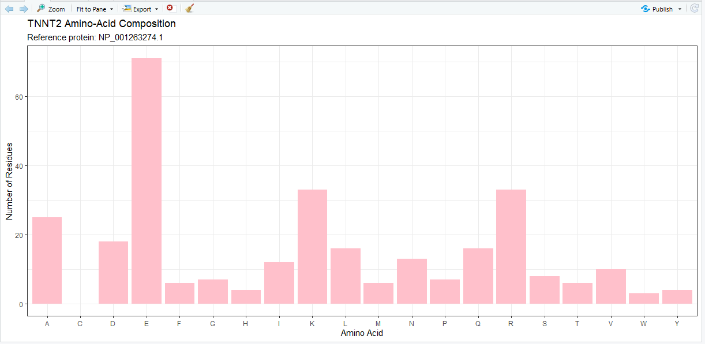
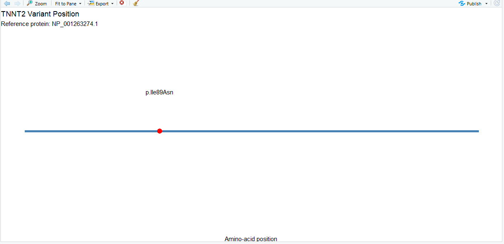

# Molecular Mechanisms of Muscle Contractility
## Protein Structure and Mutation Analysis: TNNT2

**Student:** Hobe Lagurin Palopalo  
**Course:** Cell and Molecular Biology  
**Laboratory Activity:** Individual Protein Structure and Mutation Analysis  
**Assignment Number:** 12 
**Assigned Gene:** TNNT2  
**Organism:** *Homo sapiens*   
**Reference Transcript:** NM_001276345.2   
**Reference Protein:** NP_001263274.1   
**ClinVar Variation ID:** 12408   
**Assigned Variant:** NM_001276345.2:c.266T>A (p.Ile89Asn)   
**Date Accessed:** October 28, 2026

---

# I. Objectives

1. Retrieve an assigned human gene record and matching reference protein sequence from NCBI using R.
2. Calculate protein length and amino-acid frequencies, and save an R-generated figure.
3. Analyze one PREASSIGNED, documented ClinVar variant and explain its molecular consequences without overstating evidence.
4. Use protein structure or functional-domain information to connect the gene product to muscle contraction, relaxation, calcium signaling, or muscle integrity.
5. Publish all code, results, figures, sources, and procedural notes in a reproducible individual GitHub repository.

# II. Research Question

How does the TNNT2 gene contribute to calcium-dependent cardiac muscle contraction, and how might the assigned missense variant, NM_001276345.2:c.266T>A (p.Ile89Asn), influence cardiac troponin T function and contribute to cardiomyopathy?

# III. Species and Gene Information

| Parameter | Information |
| --- | --- |
| Organism | Homo sapiens |
| Common name | Human |
| Gene symbol | TNNT2 |
| Official gene name | Troponin T2, cardiac type |
| NCBI Gene ID | 7139 |
| Chromosome | 1 |
| Cytogenetic location | 1q32.1 |
| Protein product | Cardiac troponin T |
| Reference transcript | NM_001276345.2 |
| Protein accession | NP_001263274.1 |
| Protein length | 298 amino acids |
| Functional category | Thin-filament regulation and sarcomeric signaling |
| ClinVar Variation ID | 12408 |
| Variant | c.266T>A (p.Ile89Asn) |
| Molecular consequence | Missense variant |
| Germline classification | Pathogenic |

## Biological Function of TNNT2

The TNNT2 gene encodes cardiac troponin T, a regulatory protein found in the thin filaments of cardiac muscle sarcomeres. Cardiac troponin T is part of the troponin complex, which also contains troponin I and troponin C.

Troponin T anchors the troponin complex to tropomyosin, while troponin C binds calcium ions and troponin I participates in the inhibition of actin–myosin interactions.

During cardiac excitation–contraction coupling, an increase in cytosolic calcium concentration promotes calcium binding to troponin C. This initiates conformational changes within the troponin–tropomyosin regulatory system, allowing myosin heads to interact with actin and generate contractile force.

When cytosolic calcium concentration decreases, the thin-filament regulatory system returns toward its inhibitory state, facilitating cardiac muscle relaxation.

Therefore, TNNT2 contributes to the regulation of cardiac contraction and relaxation through its role in the calcium-sensitive troponin complex.


# IV. Methodology

## Step 1. Set up your R project

A project folder named `Muscle_Contractility_TNNT2` was created for the individual laboratory activity.

The R script `analysis.R` was prepared using RStudio. Three subfolders were established to organize the retrieved sequences, analytical results, and biological visualizations.

The following packages were installed:

```r
install.packages(c("rentrez", "ggplot2"))
```

The packages were loaded using:

```r
library(rentrez)
library(ggplot2)
```

The assigned gene and variant information was defined:

```r
gene_symbol <- "TNNT2"
transcript_accession <- "NM_001276345.2"
clinvar_id <- "12408"
variant_protein <- "p.Ile89Asn"
```

The required directories were created:

```r
for (x in c("data", "results", "figures")) {
  dir.create(x, showWarnings = FALSE)
}
```

## Step 2. Retrieve your human NCBI Gene record using R

The human TNNT2 gene record was retrieved using the `rentrez` package and the NCBI Entrez database.

The search was restricted to *Homo sapiens* using taxonomy identifier 9606.

```r
hits <- entrez_search(
  db = "gene",
  term = paste0(
    gene_symbol,
    "[Gene Name] AND txid9606[Organism]"
  ),
  retmax = 20
)
```

The returned gene records were examined to confirm that the exact gene symbol matched TNNT2.

```r
gene_id <- NA_character_

for (id in hits$ids) {
  rec <- entrez_summary(db = "gene", id = id)

if (toupper(rec$name) == toupper(gene_symbol)) { gene_id <- id gene_info <- rec break } } ```

The gene summary was saved using `writeLines()`.

**Results:**

- Gene symbol: TNNT2
- NCBI Gene ID: 7139
- Official name: Troponin T2, cardiac type
- Chromosome: 1

**Output file:** `results/gene_summary.txt`

**Database:** [www.ncbi.nlm.nih.gov/gene/7139](https://www.ncbi.nlm.nih.gov/gene/7139)

## Step 3. Retrieve the matching protein sequence from the assigned transcript

The assigned RefSeq transcript NM_001276345.2 was retrieved from the NCBI Nucleotide database using `entrez_fetch()`.

```r
gb <- entrez_fetch(
  db = "nuccore",
  id = transcript_accession,
  rettype = "gb",
  retmode = "text"
)
```

The matching RefSeq protein accession was extracted from the GenBank coding-sequence annotation.

```r
pat <- '/protein_id="NP_[0-9]+[.][0-9]+"'
fragment <- regmatches(gb, regexpr(pat, gb))

protein_accession <- gsub(
  '^/protein_id="|"$', '', fragment
)
```

The corresponding protein sequence was retrieved in FASTA format.

```r
protein_fasta <- entrez_fetch(
  db = "protein",
  id = protein_accession,
  rettype = "fasta",
  retmode = "text"
)
```

The retrieved sequence was saved using:

```r
writeLines(
  protein_fasta,
  "data/TNNT2_protein.fasta"
)
```

**Results:**

- Reference transcript: NM_001276345.2
- Matching protein accession: NP_001263274.1
- Protein description: Cardiac troponin T, isoform 5
- Protein length: 298 amino acids

**Output files:**

- `data/TNNT2_protein.fasta`
- `results/protein_accession.txt`

**Database:** [www.ncbi.nlm.nih.gov/protein/NP_001263274.1](https://www.ncbi.nlm.nih.gov/protein/NP_001263274.1)

## Step 4. Analyze protein length and amino-acid composition in R

The retrieved FASTA sequence was analyzed using R to determine the total number of amino acids and the frequency of the 20 standard amino acids.

The FASTA header was excluded, and the sequence was separated into individual amino-acid residues.

```r
fasta_lines <- readLines(
  "data/TNNT2_protein.fasta"
)

sequence <- paste(
  fasta_lines[!grepl("^>", fasta_lines)],
  collapse = ""
)

aa <- strsplit(toupper(sequence), "")[[1]]

protein_length <- length(aa)

standard <- strsplit(
  "ACDEFGHIKLMNPQRSTVWY", ""
)[[1]]

counts <- table(factor(aa, levels = standard))

results <- data.frame(
  AminoAcid = standard,
  Count = as.integer(counts)
)
```

The frequency table was saved using:

```r
write.csv(
  results,
  "results/amino_acid_composition.csv",
  row.names = FALSE
)
```

A bar chart was generated using `ggplot2` and saved using `ggsave()`.

### Results

The retrieved TNNT2 reference protein contained **298 amino acids**.

The three most abundant amino acids were:

| Rank | Amino acid | Symbol | Count |
| --- | --- | --- | --- |
| 1 | Glutamic acid | E | 71 |
| 2 | Lysine | K | 33 |
| 3 | Arginine | R | 33 |

Glutamic acid was the most abundant amino acid, while lysine and arginine were equally represented.

### Figure 1. TNNT2 Amino-Acid Composition

 

**Figure 1.** Amino-acid composition of the human TNNT2 reference protein (NP_001263274.1). The bar chart illustrates the frequency of each of the 20 standard amino acids within the 298-residue protein sequence. Glutamic acid (E) was the most abundant residue, followed by lysine (K) and arginine (R).

The composition describes the primary structure of the protein but cannot independently establish its three-dimensional conformation, binding interactions, or functional consequences of the assigned variant.


## Step 5. Open and document your PREASSIGNED ClinVar record

The assigned ClinVar Variation ID 12408 was examined using the NCBI ClinVar database.

**ClinVar record:** [www.ncbi.nlm.nih.gov/clinvar/variation/12408](https://www.ncbi.nlm.nih.gov/clinvar/variation/12408/)


### Figure 2. ClinVar Evidence: TNNT2 Variant Classification


**Figure 2.** NCBI ClinVar record for the assigned TNNT2 variant, NM_001276345.2:c.266T>A (p.Ile89Asn), Variation ID 12408. The screenshot documents its pathogenic germline classification, two-star aggregate review status, missense molecular consequence, and reference transcript information.

### Figure 3. ClinVar Evidence: Associated Conditions and Supporting Submissions


**Figure 3.** ClinVar evidence showing the reported clinical associations of TNNT2 p.Ile89Asn, including dilated, hypertrophic, and restrictive cardiomyopathies. The screenshot also displays individual clinical submissions, review statuses, and supporting publication information.

**Source:** NCBI ClinVar, Variation ID 12408.
https://www.ncbi.nlm.nih.gov/clinvar/variation/12408/


### Variant Information

| Parameter | Information |
| --- | --- |
| Gene | TNNT2 |
| Variation ID | 12408 |
| ClinVar accession | VCV000012408.38 |
| Transcript | NM_001276345.2 |
| Nucleotide change | c.266T>A |
| Protein change | p.Ile89Asn |
| Variant class | Missense |
| Cytogenetic location | 1q32.1 |
| GRCh38 coordinate | Chromosome 1: 201365638 |
| Germline classification | Pathogenic |
| Aggregate review status | Two stars |
| Review description | Criteria provided, multiple submitters, no conflicts |
| Aggregate last evaluated | December 10, 2025 |
| Last submission shown | September 22, 2026 |
| Access date | October 31, 2026 |

### Associated Conditions

The ClinVar record contains pathogenic submissions associated with several cardiac disorders, including:

1. Dilated cardiomyopathy 1D
2. Hypertrophic cardiomyopathy 2
3. Cardiomyopathy, familial restrictive, 3
4. Hypertrophic cardiomyopathy
5. Other cardiomyopathy-related phenotypes

These conditions represent reported variant–disease associations and should not be interpreted as evidence that every carrier develops the same clinical phenotype.

### Molecular Consequence

The assigned variant is a missense substitution involving a thymine-to-adenine nucleotide change at coding position 266 of transcript NM_001276345.2.

This substitution changes isoleucine to asparagine at amino-acid position 89 in the assigned reference protein.

Isoleucine is a nonpolar, hydrophobic amino acid, whereas asparagine is polar and uncharged. This difference may influence local molecular interactions and the regulatory behavior of cardiac troponin T.

The same genomic variant is frequently described as p.Ile79Asn or I79N in studies using other TNNT2 protein isoforms. These differences reflect reference-sequence numbering and do not indicate a different assigned variant.

The current ClinVar pathogenic classification is supported by clinical observations, familial evidence, and published functional investigations. However, individual experimental findings must be interpreted according to the specific model and measurement used.

## Step 6. Produce a second biological visualization

A linear protein-position plot was generated using `ggplot2` to illustrate the location of the assigned TNNT2 missense variant.

The amino-acid position was extracted from the assigned protein HGVS notation.

```r
matched <- regmatches(
  variant_protein,
  regexpr("[0-9]+", variant_protein)
)

position <- as.integer(matched)
```

The position was checked against the reference protein length.

The resulting visualization represents the 298-amino-acid TNNT2 reference protein as a horizontal line, with a marker at residue 89.

### Figure 4. TNNT2 Variant Position



**Figure 4.** Linear representation of the human cardiac troponin T reference protein (NP_001263274.1), showing the location of the assigned p.Ile89Asn missense variant at amino-acid position 89. The red marker identifies the sequence position of the substitution. The figure does not independently establish structural disruption or altered protein function.

### Protein Structure and Functional-Domain Interpretation

Cardiac troponin T participates in thin-filament regulation through its interactions with tropomyosin and other troponin subunits.

The troponin complex coordinates the response of cardiac myofilaments to changes in intracellular calcium concentration.

Structural and functional studies indicate that changes in cardiac troponin T can modify thin-filament calcium sensitivity and contractile regulation.

The assigned p.Ile89Asn variant is therefore biologically relevant to calcium-dependent muscle contraction.

However, the linear protein-position plot does not reveal the precise three-dimensional arrangement of the affected residue. Any structural interpretation must account for the reference isoform, residue numbering, and available experimental evidence.

## Step 7. Explain the molecular mechanism

### Normal Molecular Mechanism

Cardiac muscle contraction is regulated through calcium-dependent interactions among actin, myosin, tropomyosin, and the troponin complex.

Following electrical excitation, cytosolic calcium concentration increases, allowing calcium ions to bind troponin C.

The resulting conformational changes are transmitted through the troponin complex, including cardiac troponin T, and influence tropomyosin positioning along actin filaments.

This permits productive actin–myosin cross-bridge interactions and contractile force generation.

During relaxation, cytosolic calcium decreases, reducing thin-filament activation and allowing cross-bridge cycling to decline.

### Proposed Effect of the Assigned Variant

The TNNT2 p.Ile89Asn substitution changes the chemical properties of one amino-acid residue within cardiac troponin T.

Published functional studies of the equivalent I79N variant have reported altered calcium sensitivity and contractile behavior.

Some experimental preparations demonstrated increased calcium sensitivity, whereas other models reported different effects on force development. These findings indicate that the measured consequences can depend on the experimental system.

More recent investigations using reconstituted cardiac thin filaments and induced pluripotent stem cell-derived cardiomyocytes have demonstrated increased myofilament calcium sensitivity, altered calcium dissociation kinetics, and abnormalities in calcium handling and electrical stability.

These results support a mechanism involving altered thin-filament regulation, although they do not establish that every carrier experiences identical cellular or clinical effects.

### Causal Chain

**TNNT2 gene → Cardiac troponin T → Calcium-dependent thin-filament regulation → p.Ile89Asn missense substitution → Altered calcium sensitivity and contractile regulation → Possible contribution to cardiomyopathy.**

### Proposed Validation Experiment

A calcium-dependent contractile force assay could be performed using human induced pluripotent stem cell-derived cardiomyocytes carrying the TNNT2 p.Ile89Asn variant.

Variant-containing cardiomyocytes would be compared with genetically matched control cardiomyocytes.

The experiment would measure calcium transients, contractile force, and relaxation characteristics under standardized stimulation conditions.

Differences between the variant and control groups could help determine whether the substitution affects calcium responsiveness and mechanical performance.

This experiment is proposed for validation and was not performed during the present computational laboratory activity.

# V. Questions to answer 

### 1. What does your assigned gene encode, and how does this protein contribute to muscle function?

The TNNT2 gene encodes cardiac troponin T, a regulatory protein located in the thin filaments of cardiac muscle sarcomeres. Cardiac troponin T is one of the three components of the troponin complex, together with troponin I and troponin C. Its primary role is to connect the troponin complex to tropomyosin and contribute to calcium-dependent regulation of actin–myosin interactions. During cardiac muscle contraction, calcium binds to troponin C, initiating conformational changes that permit myosin to interact with actin. Cardiac troponin T helps transmit these regulatory changes through the thin filament. Consequently, TNNT2 contributes to the coordinated contraction and relaxation of cardiac muscle.

### 2. What was the exact protein accession and length retrieved with R?

The matching reference protein retrieved from the NCBI Protein database was **NP_001263274.1**, corresponding to cardiac troponin T isoform 5. The protein sequence was obtained using the assigned transcript NM_001276345.2 and the `rentrez` package in RStudio. Sequence analysis determined that the reference protein contains **298 amino acids**. The retrieved FASTA sequence was saved as `data/TNNT2_protein.fasta`, while the protein accession was documented in `results/protein_accession.txt`.

### 3. What did the amino-acid composition chart show? What can it NOT tell you?

The amino-acid composition chart showed the distribution of the 20 standard amino acids in the 298-residue TNNT2 reference protein. Glutamic acid (E) was the most abundant amino acid, with 71 residues, followed by lysine (K) and arginine (R), with 33 residues each. These findings describe the relative abundance of amino acids within the protein's primary sequence. However, the chart cannot determine the protein's three-dimensional structure, folding stability, molecular interactions, or contractile activity. It also cannot establish whether the assigned missense variant causes functional impairment. Such conclusions require additional structural or experimental evidence.

### 4. What is your fixed ClinVar variant, and what is its current classification and evidence strength?

The assigned ClinVar variant is **NM_001276345.2:c.266T>A (p.Ile89Asn)**, with ClinVar Variation ID 12408. It is a missense variant that replaces isoleucine with asparagine at amino-acid position 89 in the assigned reference protein. As accessed on October 31, 2026, ClinVar classified the variant as **pathogenic** for germline disease, with a two-star aggregate review status indicating criteria provided by multiple submitters without conflicting classifications. The record includes associations with hypertrophic, dilated, and restrictive cardiomyopathies. Supporting evidence includes clinical observations, familial studies, and published functional experiments. Although the pathogenic classification is supported by multiple sources, the precise molecular effects and clinical presentation may vary.

### 5. What is the scientifically supported mechanism linking this variant to muscle function, and what remains uncertain?

The TNNT2 p.Ile89Asn variant affects cardiac troponin T, which contributes to calcium-dependent regulation of thin-filament contraction. Experimental investigations of the equivalent I79N variant have demonstrated changes in myofilament calcium sensitivity and contractile behavior. Some studies have reported increased calcium responsiveness and altered calcium dissociation kinetics, suggesting that the substitution can influence thin-filament activation and relaxation. These effects may contribute to abnormal cardiac muscle function and cardiomyopathy. However, experimental results vary between biological models, and the exact molecular interactions responsible for the changes are not completely established. The clinical consequences also cannot be predicted solely from the amino-acid substitution or the position shown in the protein map.

### 6. What additional experiment would help test the proposed mechanism?

An additional experiment would involve comparing calcium-dependent contractile responses in human induced pluripotent stem cell-derived cardiomyocytes containing the TNNT2 p.Ile89Asn variant and genetically matched control cells. Calcium imaging could measure intracellular calcium transients, while contractile force measurements could evaluate mechanical performance. The experiment could also examine relaxation kinetics following electrical stimulation. Differences between the variant and control cells would provide evidence about whether the substitution alters calcium sensitivity, contractile force, or relaxation. Such findings could help clarify the molecular relationship between the TNNT2 variant and cardiac muscle dysfunction.

# VI. Scientific Discussion 

The TNNT2 gene encodes cardiac troponin T, an essential regulatory component of the cardiac thin filament. Through its interactions with tropomyosin and other troponin subunits, cardiac troponin T contributes to calcium-dependent control of actin–myosin cross-bridge formation. Alterations in this regulatory system can influence cardiac muscle contraction and relaxation and have been associated with inherited cardiomyopathies.

In this laboratory activity, the human TNNT2 gene and its matching reference protein were retrieved from NCBI using RStudio. The assigned transcript, NM_001276345.2, corresponded to protein accession NP_001263274.1, containing 298 amino acids. Amino-acid composition analysis identified glutamic acid as the most abundant residue, followed by lysine and arginine. These results characterized the protein's primary sequence but did not independently establish its biological activity or structural stability.

The assigned ClinVar variant, c.266T>A (p.Ile89Asn), is a missense substitution involving the replacement of nonpolar isoleucine with polar asparagine. ClinVar classified the variant as pathogenic with a two-star aggregate review status. Clinical submissions associate this variant with several forms of cardiomyopathy, including hypertrophic, dilated, and restrictive cardiomyopathies. These clinical associations support its medical significance but do not demonstrate that every carrier will develop an identical phenotype.

Experimental studies provide additional evidence concerning its molecular consequences. Research investigating the equivalent I79N variant has demonstrated altered calcium sensitivity and contractile regulation. Yanaga and colleagues (1999) reported increased calcium sensitivity of myofibrillar ATPase activity, whereas other experimental models have produced differing results concerning calcium-dependent force development. More recent research using reconstituted cardiac thin filaments and stem cell-derived cardiomyocytes demonstrated increased myofilament calcium sensitivity, slower calcium dissociation, and abnormalities in cellular calcium handling and electrical stability.

These observations support a relationship between the TNNT2 variant and altered thin-filament regulation. Nevertheless, differences among experimental systems indicate that the precise molecular mechanism cannot be explained by a single measurement. Computational predictions and amino-acid properties may suggest possible structural effects, but they cannot substitute for direct functional evidence.

The protein-position visualization generated in R identified residue 89 within the assigned reference sequence. However, this representation established only the variant's location and did not demonstrate changes in protein folding or binding interactions.

Further investigation using genetically matched cardiomyocytes, calcium imaging, and contractile force measurements could clarify the functional consequences of the substitution. Overall, the laboratory demonstrates how sequence analysis, clinical variant databases, and experimental research can be integrated to investigate the molecular mechanisms connecting TNNT2 variation to cardiac muscle dysfunction.

# VII. Limitations

1. The laboratory primarily involved computational sequence analysis and database investigation rather than direct experimental testing of cardiac muscle contraction.
2. Amino-acid composition describes the primary protein sequence but does not establish three-dimensional structure or biological function.
3. The variant-position plot identifies the affected amino-acid residue but cannot demonstrate altered molecular interactions.
4. Published experimental findings may differ according to the biological model, protein isoform, and measurement technique.
5. Clinical variant classifications may change as additional evidence becomes available.
6. The pathogenic classification does not independently predict disease severity, age of onset, or clinical presentation in an individual carrier.
7. The present laboratory did not experimentally validate the proposed effects of the TNNT2 variant.

## Reproducibility Instructions

To reproduce the analysis:

1. Install R and RStudio.
2. Obtain the repository files and open the project folder in RStudio.
3. Install the required R packages:

```r
install.packages(c("rentrez", "ggplot2"))
```

4. Open the `analysis.R` script.
5. Set the working directory to the repository folder.
6. Execute the script:

```r
source("analysis.R")
```

7. Verify that the script retrieves the TNNT2 gene and matching protein sequence.
8. Examine the generated CSV and PNG files in the `results` and `figures` directories.
9. Compare the variant information with the assigned ClinVar record.

**Troubleshooting:** If an NCBI request fails because of connectivity problems or temporary database restrictions, rerun the affected retrieval step. Do not substitute another gene, transcript, or ClinVar Variation ID. If an accession or clinical interpretation changes, document the discrepancy while retaining the assigned variant.

## Expected Outputs

- NCBI TNNT2 gene information
- Matching RefSeq protein accession and FASTA sequence
- Protein length of 298 amino acids
- Amino-acid composition frequency table
- Amino-acid composition bar chart
- TNNT2 variant-position visualization
- ClinVar variant analysis
- Molecular mechanism interpretation
- Scientific discussion and proposed validation experiment

# VIII. References

1. National Center for Biotechnology Information (NCBI). (2026). *TNNT2 troponin T2, cardiac type (Homo sapiens), Gene ID: 7139.* NCBI Gene. [www.ncbi.nlm.nih.gov/gene/7139](https://www.ncbi.nlm.nih.gov/gene/7139)

2. National Center for Biotechnology Information (NCBI). (2026). *NP_001263274.1: Cardiac troponin T isoform 5 (Homo sapiens).* NCBI Protein. [www.ncbi.nlm.nih.gov/protein/NP_001263274.1](https://www.ncbi.nlm.nih.gov/protein/NP_001263274.1)

3. National Center for Biotechnology Information (NCBI). (2026). *NM_001276345.2(TNNT2):c.266T>A (p.Ile89Asn), Variation ID: 12408.* ClinVar. [www.ncbi.nlm.nih.gov/clinvar/variation/12408](https://www.ncbi.nlm.nih.gov/clinvar/variation/12408/)

4. Thierfelder, L., Watkins, H., MacRae, C., Lamas, R., McKenna, W., Vosberg, H. P., Seidman, J. G., & Seidman, C. E. (1994). Alpha-tropomyosin and cardiac troponin T mutations cause familial hypertrophic cardiomyopathy: A disease of the sarcomere. *Cell, 77*(5), 701–712. [pubmed.ncbi.nlm.nih.gov/8205619](https://pubmed.ncbi.nlm.nih.gov/8205619/)

5. Yanaga, F., Morimoto, S., & Ohtsuki, I. (1999). Ca2+ sensitization and potentiation of the maximum level of myofibrillar ATPase activity caused by mutations of troponin T found in familial hypertrophic cardiomyopathy. *Journal of Biological Chemistry, 274*(13), 8806–8812. [pubmed.ncbi.nlm.nih.gov/10085122](https://pubmed.ncbi.nlm.nih.gov/10085122/)

6. *Functional analyses of troponin T mutations that cause hypertrophic cardiomyopathy: Insights into disease pathogenesis and troponin function.* (1998). *Proceedings of the National Academy of Sciences, 95*(24), 14406–14410. [pubmed.ncbi.nlm.nih.gov/9826713](https://pubmed.ncbi.nlm.nih.gov/9826713/)

7. *Mechanisms of Arrhythmogenicity of Hypertrophic Cardiomyopathy-Associated Troponin T (TNNT2) Variant I79N.* (2022). PubMed. [pubmed.ncbi.nlm.nih.gov/34977031](https://pubmed.ncbi.nlm.nih.gov/34977031/)

8. UniProt Consortium. *UniProt Protein Knowledgebase: TNNT2.* [www.uniprot.org/uniprotkb/?query=gene:TNNT2+AND+organism_id:9606](https://www.uniprot.org/uniprotkb/?query=gene:TNNT2+AND+organism_id:9606)

9. RCSB Protein Data Bank. *Protein structure database.* [www.rcsb.org](https://www.rcsb.org/)

10. rOpenSci. *rentrez: Entrez in R.* [docs.ropensci.org/rentrez](https://docs.ropensci.org/rentrez/)

**Database access date:** October 28, 2026.

# IX. Conclusion

The laboratory activity successfully retrieved and analyzed the human TNNT2 gene and its corresponding reference protein using RStudio and NCBI databases. The retrieved protein, NP_001263274.1, contained 298 amino acids, with glutamic acid, lysine, and arginine representing the most abundant residues.

The assigned ClinVar variant, c.266T>A (p.Ile89Asn), was documented as a pathogenic missense substitution associated with inherited cardiomyopathies. Published functional investigations support a relationship between this variant and altered calcium-dependent regulation of cardiac muscle contraction.

The findings demonstrate the importance of integrating bioinformatics analysis, clinical variant interpretation, and experimental evidence when investigating molecular mechanisms of muscle contractility. Further experimental validation remains necessary to characterize the precise effects of the variant under different biological conditions.
